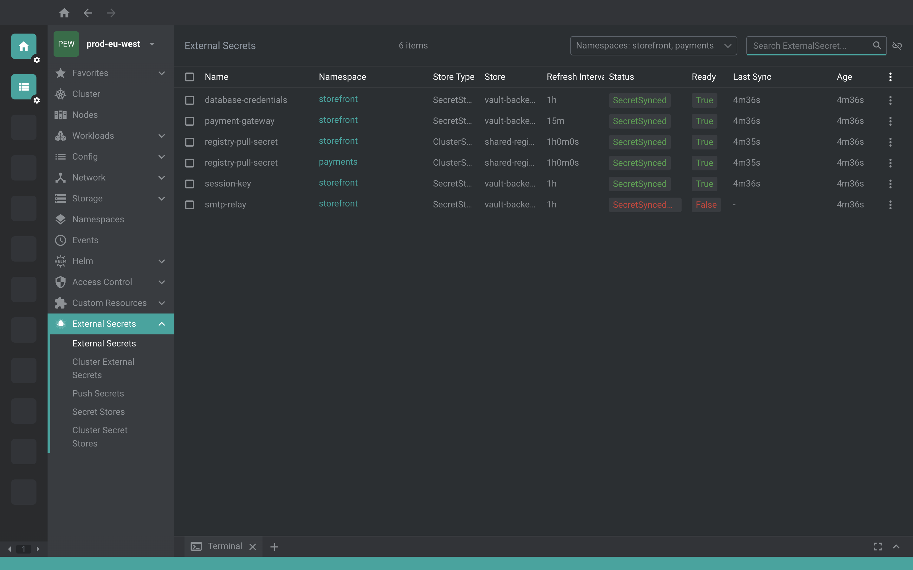
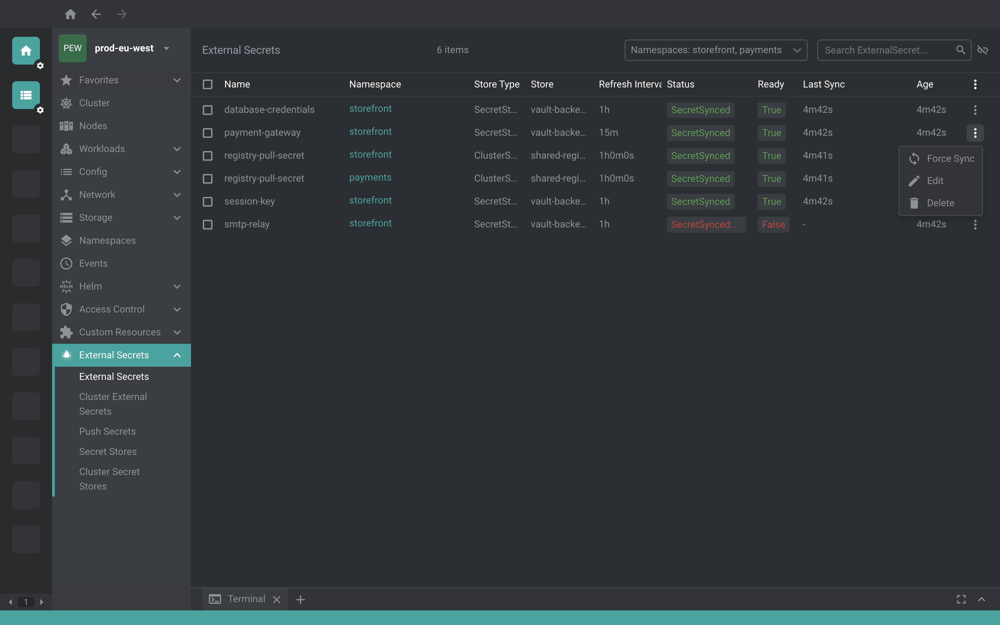
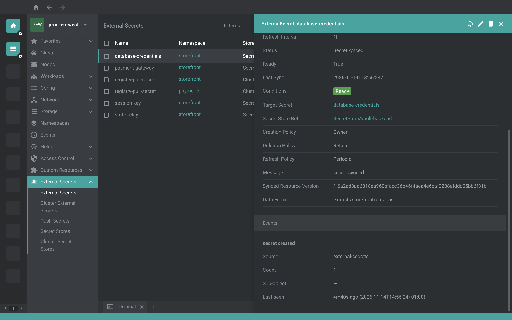

# @freelensapp/eso-extension

<!-- markdownlint-disable MD013 -->

[](https://freelens.app)
[](https://github.com/freelensapp/freelens-eso-extension)
[](https://github.com/freelensapp/freelens-eso-extension/releases)
[](https://github.com/freelensapp/freelens-eso-extension/actions/workflows/integration-tests.yaml)
[](https://www.npmjs.com/package/@freelensapp/eso-extension)

<!-- markdownlint-enable MD013 -->

## Overview

[Freelens](https://freelens.app) extension for the
[External Secrets Operator](https://external-secrets.io) (ESO), which syncs the
secrets of an external store, such as a cloud secret manager or Vault, into
Kubernetes Secrets, and pushes Secrets back to a store.

The extension lives in the cluster sidebar under **External Secrets**:
**External Secrets**, **Cluster External Secrets**, **Push Secrets**, **Secret
Stores** and **Cluster Secret Stores**, with the columns of `kubectl get` and
the sync status of each object at a glance. Each kind has a details panel with
what the details of Freelens leave out, the details of a Secret that ESO
manages link back to its ExternalSecret, and the menu of an ExternalSecret or a
ClusterExternalSecret forces a sync.

[Video Demo](https://github.com/user-attachments/assets/5e46338e-94e6-4aeb-93d0-cb4f30148066)







## Authors

- [Nídio Dolfini](https://github.com/nidiodolfini) created this extension,
  ported it to the extension API of Freelens 2, and maintains it.
- [Roberto Bandini](https://github.com/robertobandini) reviewed it and brought
  it into the organization.

## Requirements

- Freelens 2.0.0 or a later 2.x (extension API v2). Freelens 1.x needs a 1.x
  version of the extension, `freelens-eso-extension` 1.0.5, which is no longer
  maintained.
- The External Secrets Operator, serving `external-secrets.io/v1`, as ESO does
  from 0.16 on, or `external-secrets.io/v1beta1` of an older release. The
  extension follows ESO 2.14.

## Supported APIs

| Group                 | API Version | Kind                    | Shown in                 |
| --------------------- | ----------- | ----------------------- | ------------------------ |
| `external-secrets.io` | v1, v1beta1 | `ExternalSecret`        | External Secrets         |
| `external-secrets.io` | v1, v1beta1 | `ClusterExternalSecret` | Cluster External Secrets |
| `external-secrets.io` | v1alpha1    | `PushSecret`            | Push Secrets             |
| `external-secrets.io` | v1, v1beta1 | `SecretStore`           | Secret Stores            |
| `external-secrets.io` | v1, v1beta1 | `ClusterSecretStore`    | Cluster Secret Stores    |

ESO 0.16 introduced `v1` for ExternalSecret, ClusterExternalSecret,
SecretStore and ClusterSecretStore, with the same schema as `v1beta1`, and ESO
0.17 stopped serving `v1beta1`. The extension uses `v1` wherever the cluster
serves it, and `v1beta1` on an older ESO: the pages, the details, Force Sync
and the links work the same with both. The fields that ESO has added to `v1`
since 0.16 are absent from the objects of an older release, and so from their
details. PushSecret is at `v1alpha1` in every release.

When the cluster does not serve a kind, its page says so. While the extension
is enabled, the five kinds are left out of the Custom Resources tree of the
cluster sidebar, so each of them is listed once, under External Secrets.

## Permissions

The pages list and watch the five kinds. The panel of a Secret reads its owner
reference and its labels, which Freelens already loads. Force Sync patches an
annotation of the ExternalSecret or ClusterExternalSecret, so it needs `patch`
on `externalsecrets` in the namespace of the object, or on
`clusterexternalsecrets`; without it, Freelens shows the error of the patch.
Nothing else writes to the cluster.

## Install

Open Freelens and go to Extensions (`ctrl`+`shift`+`E` or
`cmd`+`shift`+`E`). The field at the top takes a package name, the URL of a
tarball, or the path to a tarball or a directory.

### From the registry

Enter `@freelensapp/eso-extension` and press Install.

Alternatively, open the following URL in the browser to install directly:

[freelens://app/extensions/install/%40freelensapp%2Feso-extension](freelens://app/extensions/install/%40freelensapp%2Feso-extension)

### From a release tarball

Each [release](https://github.com/freelensapp/freelens-eso-extension/releases)
has the extension as `freelensapp-eso-extension-<version>.tgz`, with its
checksum in `freelensapp-eso-extension-<version>.tgz.sha256`. Use a release
whose major version matches your Freelens version.

- Enter the URL of the `.tgz` asset and press Install. Freelens downloads the
  `.tgz.sha256` next to it and checks the tarball against it.
- Or download both files into one directory and enter the path to the `.tgz`,
  or drop the `.tgz` on the Freelens window. Freelens checks it against the
  `.tgz.sha256` next to it.

### From a directory

Build the extension (see below), then enter the path to your checkout, the
directory with `package.json`, and press Install. Freelens runs the extension
from that directory, from the files in `dist/`, and lists it as unverified.
This is how you work on the extension: see
[Development loop](#development-loop).

## Getting started

The objects in `examples/eso/` show every view on a cluster with ESO
installed:

```sh
kubectl apply -f examples/eso/secretstore.yaml
kubectl apply -f examples/eso/clustersecretstore.yaml
kubectl apply -f examples/eso/externalsecret.yaml
kubectl apply -f examples/eso/clusterexternalsecret.yaml
kubectl apply -f examples/eso/pushsecret.yaml
```

They use the `fake` provider of ESO, which serves the pair `/hello` to `world`
without touching any real secret backend:

| File                         | Objects                                                                                       |
| ---------------------------- | --------------------------------------------------------------------------------------------- |
| `secretstore.yaml`           | the SecretStore `fake-store`                                                                  |
| `clustersecretstore.yaml`    | the ClusterSecretStore `fake-cluster-store`                                                   |
| `externalsecret.yaml`        | the ExternalSecret `hello-world`, which creates the Secret `hello-world` with the key `hello` |
| `clusterexternalsecret.yaml` | the ClusterExternalSecret that creates the ExternalSecret `hello-everywhere` in `default`     |
| `pushsecret.yaml`            | the PushSecret that pushes the Secret `hello-world` back into `fake-store`                    |

Open the cluster in Freelens. The pages list the objects; the details of
`hello-world` show `Ready` with `SecretSynced` after the first sync, and the
details of the Secret `hello-world` link back to it. Then open the menu of
`hello-world` and choose **Force Sync**: the Last Sync column updates within
seconds, as the controller reconciles.

## Features

### Lists

- **External Secrets** (`es`): Name, Namespace, Store Type, Store, Refresh
  Interval, Status, Ready, Last Sync and Age, as `kubectl get es`.
- **Cluster External Secrets** (`ces`): Name, Store Type, Store, Refresh
  Interval, the number of provisioned namespaces, with the failed ones as a
  badge, Ready and Age.
- **Push Secrets** (`ps`): Name, Namespace, the source Secret, the stores it is
  pushed to, Refresh Interval, Status, Ready, Last Sync and Age.
- **Secret Stores** (`ss`): Name, Namespace, Provider, Status, Capabilities,
  Ready and Age.
- **Cluster Secret Stores** (`css`): the same, without Namespace.

The status comes from the `Ready` condition of each object, as a colored badge
with the reason of the controller, such as `SecretSynced`, `SecretSyncedError`,
`Valid` or `ValidationFailed`. Last Sync shows the time since the last sync, as
`kubectl get` does, with the date in its tooltip. The columns of every list can
be resized, and hidden from the menu at the right of the header, which keeps a
list readable in a narrow window; a cut value shows whole in its tooltip.

### Details

Each panel sits in the drawer next to the details that Freelens shows for a
custom resource, with the columns of the CRD and the conditions, and shows what
they leave out:

- **ExternalSecret**: its target Secret and its store as links, the creation
  and deletion policies, the refresh policy, the message of a failed sync, the
  synced resource version, and its `data` and `dataFrom` mappings.
- **ClusterExternalSecret**: the ExternalSecrets it creates, its store, the
  namespace selectors, and the provisioned and failed namespaces.
- **PushSecret**: its source Secret and its stores as links, its update and
  deletion policies, and its `data` and `dataTo` mappings.
- **SecretStore** and **ClusterSecretStore**: the provider, the controller,
  the retry settings and the message of a failed validation.
- **Secret**: the details of a Secret that ESO manages gain an "External
  Secrets" panel with a link to the ExternalSecret that owns it, from the
  owner reference and the managed label of the Secret.

### Write actions

**Force Sync**, in the menu of an ExternalSecret or a ClusterExternalSecret,
writes a fresh timestamp to the `external-secrets.io/force-sync` annotation,
as `kubectl annotate es <name> force-sync=$(date +%s) --overwrite` does. The
controller reconciles whenever the annotation changes, so the Secret is
refreshed right away, and a ClusterExternalSecret passes the sync on to the
ExternalSecrets it manages. A notification confirms the request, or says why it
failed, such as a missing permission to patch the object. The stores and the
PushSecret take no such action, so they have no menu item.

## Limits

- **Five kinds.** The ClusterPushSecret of `external-secrets.io/v1alpha1` and
  the generators of `generators.external-secrets.io` have no page.
- **No forms.** The extension creates no object and edits no field besides the
  force-sync annotation; the editor of Freelens, or `kubectl`, does the rest.
- **One API version per kind.** The extension reads `v1` where the cluster
  serves it, and `v1beta1` otherwise; the fields of `v1` that an older release
  does not have are not shown.

## Build from the source

### Prerequisites

Use [NVM](https://github.com/nvm-sh/nvm),
[mise-en-place](https://mise.jdx.dev/), or
[windows-nvm](https://github.com/coreybutler/nvm-windows) to install the
Node.js version in `.nvmrc`.

From the root of this repository:

```sh
nvm install
# or
mise install
# or
winget install CoreyButler.NVMforWindows
nvm install "$(cat .nvmrc)"
nvm use "$(cat .nvmrc)"
```

Install pnpm:

```sh
corepack install
# or
curl -fsSL https://get.pnpm.io/install.sh | sh -
# or
winget install pnpm.pnpm
```

### Build extension

```sh
pnpm install
pnpm build
```

The extension is built into `dist/`. To pack it into a tarball:

```sh
pnpm pack
```

One script to bump the prerelease version, build and pack the extension for
testing:

```sh
pnpm pack:dev
```

The tarball is placed in the current directory. Install it as described in
[From a release tarball](#from-a-release-tarball).

### Development loop

Install the extension from your checkout once, as described in
[From a directory](#from-a-directory), then run:

```sh
pnpm dev
```

It rebuilds the extension whenever a source file changes, and Freelens
reloads the extension after each rebuild, without a restart and without
packing. Stop it with `ctrl`+`C`.

Neither `pnpm build` nor `pnpm dev` type-checks; run `pnpm type:check` for
that. A change to `main` or `renderer` in `package.json` needs Freelens
restarted once.

To check the extension in Freelens with an AI agent, see "Checking the
Extension in Freelens Dev" in [AGENTS.md](AGENTS.md).

### Check the code

```sh
pnpm type:check
pnpm test:unit
pnpm lint:check
pnpm knip:check
```

and, for the formats that Biome does not cover:

```sh
pnpm trunk:check
```

### Integration tests

The integration tests drive Freelens dev, started from a
[freelensapp/freelens](https://github.com/freelensapp/freelens) checkout,
against a [kind](https://kind.sigs.k8s.io/) cluster. In the Freelens checkout:

```sh
pnpm dev
```

Freelens dev lists no cluster until a kubeconfig is added in Preferences >
Kubernetes > Kubeconfig Syncs. Add one with the kind cluster, for example:

```sh
kubectl config view --minify --flatten --context kind-kind > ~/kind-kind.kubeconfig
```

Then, with the kind cluster running, in the extension repository:

```sh
pnpm build
pnpm test:integration
```

The tests install the checkout in place, replacing any other installation of
the extension in Freelens dev. They run one session with ESO 2.14.0, which
serves `external-secrets.io/v1`, and one with ESO 0.15.1, which serves only
`external-secrets.io/v1beta1`. Each applies the CRDs of the five kinds from the
sources of its release, without the controller, and deletes them at the end,
and with them every object of those kinds on the cluster, so use a kind cluster
with nothing worth keeping, never one where ESO is in use. Without Freelens dev
or the cluster the tests are skipped.

Optional variables:

- `TEST_KIND_CLUSTER_NAME`: the kind cluster, `kind` by default, used
  through the context `kind-<name>`.
- `FREELENS_CDP_URL`: the CDP endpoint of Freelens dev,
  `http://127.0.0.1:9223` by default.
- `FREELENS_MAIN_LOG`: a log of the main process to check for errors, such
  as its `lens.log`. Without it only the renderer's errors are checked.

## License

Copyright (c) 2025-2026 Freelens Authors.

[MIT License](https://opensource.org/licenses/MIT)
